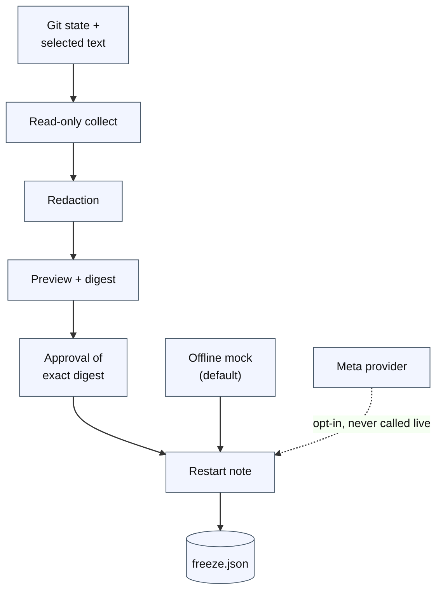

# CLG: Context Freeze v1

A local prototype that helps a developer resume an interrupted task. You pick a
Git repository and a short terminal excerpt, review a redacted preview, and save
a structured restart note. Check Git state again before you resume.

**Inference defaults to an offline mock.** The mock leaves the task and blocker as
unknown instead of guessing. A Meta Model API provider (`provider='meta'`) exists
in `clg/core.py`, but it has never made a live call: it needs `MODEL_API_KEY`,
and no key, credits or billing are configured. The mock remains the default in
both interfaces.

## Architecture

The constraint this project is built around: **nothing is inferred, sent or saved until you approve the exact redacted preview, and no command ever runs.**



1. Collection is read-only: branch, commit and tracked changed filenames, never file contents or terminal history, with a scrubbed environment and a 5-second timeout on each git call (clg/core.py).
2. The selected text is capped at 12,000 characters and heuristically redacted (keys, tokens, authorization lines, local paths); sensitive-looking filenames are omitted and counted. The preview itself carries the warning that redaction is not a guarantee.
3. Approval is bound to the preview's SHA-256 digest: approve a different digest and the note is refused.
4. The default inference is an offline mock that leaves task and blocker as unknown rather than guessing. A Meta provider exists but has never made a live call; it is opt-in and needs MODEL_API_KEY.
5. The review UI is loopback-only with a per-launch token and host checks; the CLI saves exclusively and never silently overwrites an existing note.

Design decisions and limits: [docs/ARCHITECTURE.md](docs/ARCHITECTURE.md).

## Run

Requires Python 3.10+ and Git. No third-party Python packages.

```sh
python3 -m unittest discover -s tests -v
python3 demo.py
python3 -m clg.ui --repo /path/to/your/demo/repo
```

Open the loopback address the app prints. Start with a synthetic repository.
There is also a CLI:

```sh
python3 -m clg --repo /path/to/demo/repo --selection /path/to/selected.txt
```

Review the preview, then repeat with `--approve DIGEST --out /new/path/freeze.json`.
The UI downloads a JSON note after approval. Neither interface executes next steps.

## What works

- Explicit repository and optional selected text, capped at 12,000 characters.
- Read-only branch, commit and tracked changed filenames. No source contents or global history.
- Heuristic secret and path redaction. Approval is bound to the exact preview digest.
- Validated evidence inventory and one to three evidence-linked next steps.
- A warning when the branch or commit changed. Any tracked dirty state needs manual review.
- Exclusive CLI save that never silently overwrites an existing note.
- Loopback-only UI with request-token and origin/host checks.

## Limits

Redaction is not a guarantee. Review every field before saving or sharing.
Untracked files, external state and dirty file contents are not checked.
A restart note is not a source backup. The UI is an early prototype, not hardened
multi-user software. Not implemented: model calls, automatic commands, camera
sensing, a phone companion and measured fatigue detection.

Still to build: a verified live Meta call, failure-mode evaluation and a recorded
working demo. This is not a finished hackathon submission.

## Build provenance

This implementation began on October 26, 2026, after 12:47 pm America/Toronto,
following the kickoff. It does not copy implementation from the older private
Context Freeze repository or the separate morning prototype. The earlier concept
predates the event. Actual development times are retained, and no eligibility
certification is made.

Python and browser code use only their standard libraries. No third-party code,
model weights, assets or dependency packages are bundled. No license grant is
included at this stage.
